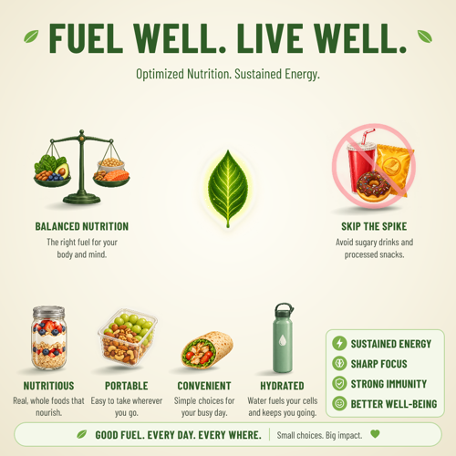
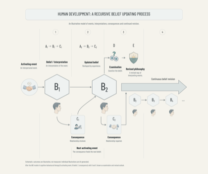

# XYZ Layout Engine

XYZ Layout Engine turns a JSON fixture into a pixel-exact infographic or diagram. It renders the same
input to the same PNG, SVG and HTML bytes every time, offline, with no AI model or network call at
render time.

AI tools are good at taste and bad at exact typography, data binding and repeatable edits. This repo
splits the two jobs:

- **AI does the authoring.** An agent turns a reference image or a `DESIGN.md` brief into a versioned
  recipe (`tools/recipes/*.mjs`), a `fixture.json` that owns the copy, palette and coordinates, and
  optional transparent PNG cutouts. The anti-slop rules in
  [`SYSTEM-INSTRUCTIONS.md`](SYSTEM-INSTRUCTIONS.md) govern the result.
- **The engine does the rendering.** [`tools/render.mjs`](tools/render.mjs) validates the fixture,
  fits text, embeds bundled fonts and pinned assets, and exports through Satori + resvg or headless
  Chromium. Every export comes with a receipt of digests and versions.

Once a recipe and its assets exist, anyone (a developer, a CI job, a local LLM) can change copy,
colours or positions with one command and re-render in seconds.

| Nutrition infographic (`nutrition` recipe) | Feedback-loop diagram (`recursive-process` recipe) |
|---|---|
|  |  |

> **Status:** local MVP, written in ESM JavaScript (TypeScript is a product target). It is a private
> package (`0.0.0`): there is no npm release, HTTP server, MCP server or `bin` entry yet. You use it
> through the CLIs below, from a checkout of this repository.

## Contents

- [Requirements](#requirements)
- [Quick start](#quick-start)
- [How it works](#how-it-works)
- [Command-line tools](#command-line-tools)
- [Recipes](#recipes)
- [Examples](#examples)
- [Authoring with an AI agent](#authoring-with-an-ai-agent)
- [Accessible PDF export](#accessible-pdf-export)
- [Recipe and design catalog](#recipe-and-design-catalog)
- [Capabilities and limits](#capabilities-and-limits)
- [Repository layout](#repository-layout)
- [Contributing](#contributing)
- [Dependency and font notices](#dependency-and-font-notices)

## Requirements

- **Node 22.13 or newer.** The catalog uses unflagged `node:sqlite` and PNG loading uses
  `node:zlib` `crc32`. Verified on 22.22.3, 24.21.0 and 26.13.0. On Node 18, install succeeds but
  the first render fails with `The requested module 'node:zlib' does not provide an export named
  'crc32'`: upgrade Node.
- **pnpm** (verified with 12.21.0). Without pnpm on your PATH, prefix the `pnpm` commands below with
  `npx --yes`, for example `npx --yes pnpm install --frozen-lockfile`.
- **Chromium for Playwright**, a one-time download from `cdn.playwright.dev`:
  `pnpm exec playwright install chromium`. `pnpm test` needs it, as do `--backend playwright`, PDF
  export and the example scripts that also make a Chromium render. Satori renders (quick-start steps
  1 and 2) do not.
- The recorded and tested host is macOS on Apple silicon (darwin-arm64). Other platforms are untested.

## Quick start

Run everything from the repository root. Installing dependencies and Chromium uses the network;
nothing after that does. `temp/` is gitignored, so it is a safe place for scratch output.

```sh
pnpm install --frozen-lockfile
pnpm exec playwright install chromium   # one-time; needed by step 3

# 1. Render a committed example to PNG, SVG and HTML
node tools/render.mjs examples/2026-10-13-nutrition-infographic/fixture.json \
  --format png,svg,html,html-inline --out temp/nutrition

# 2. Edit a copy of a fixture, save the edit, and re-render
cp examples/2026-10-08-solar-system/fixture.json temp/solar.json
node tools/render.mjs temp/solar.json --recipe solar-system \
  --set 'planets.0.labelX=830' --save temp/solar.json --format svg --out temp/solar

# 3. Run the test suite (4 canaries, about 30 seconds)
pnpm test
```

Open the result: `temp/nutrition/manifest.json` has a `current` field such as `runs/<uuid>`. That
folder holds `render.png`, `render.svg`, `render.html` (with its `assets/` folder),
`render-inline.html` (self-contained) and `result.json`, the render receipt.

`--set` alone gives a one-off preview and leaves the fixture unchanged. Add `--save` to write the
edit back to the JSON.

## How it works

```text
fixture.json ──► recipe (tools/recipes/*.mjs) ──► scene ──► Satori + resvg ──► PNG / SVG / HTML
  copy, palette,    trusted layout code,          fitted     or Chromium        + result.json receipt
  coordinates       canvas size, font             text                          + manifest.json
```

- **Fixture**: a JSON file holding the content (text, colours, coordinates, asset paths). Fixtures
  are capped at 256 KiB and validated before rendering.
- **Recipe**: trusted, versioned JavaScript that turns a fixture into a scene. A recipe owns its
  canvas size and font. Recipes are identified as `slug@semver` and hashed in the catalog.
- **Backends**: `satori` (default, makes PNG, SVG and HTML) or `playwright` (headless Chromium, makes
  PNG and HTML). The engine never switches backend for you.
- **Exports are atomic**: each render goes to a new `runs/<uuid>/` folder, and the top-level
  `manifest.json` points to the latest one. A failed render never leaves a half-written export.
- **Receipts**: `result.json` records versions, SHA-256 digests, asset provenance, text-fitting steps
  and catalog verification (`verified: true/false`, with a reason when false).

## Command-line tools

| Command | What it does |
|---|---|
| `node tools/render.mjs` (`pnpm render`) | Render a fixture. The main tool. |
| `node tools/intake.mjs` | Preflight a `design-intake` fixture without rendering. |
| `node tools/pdf.mjs` | Export a tagged, accessible PDF and check an existing one. |
| `node tools/catalog.mjs` | List, show, verify and publish recipes; record designs. |
| `node tools/deck-viewer.mjs` (`pnpm deck:viewer`) | Build a static HTML viewer for a folder of slides. |
| `node tools/profile.mjs` (`pnpm profile`) | Time cold and warm renders and print JSON statistics. |
| `pnpm test` | Run the test suite within the limits in `test-budget.json`. |
| `pnpm spike:render`, `pnpm spike:verify` | Historical GH-1 backend comparison and its acceptance check. |

### `tools/render.mjs`

```text
node tools/render.mjs <fixture.json> [--out DIR] [--format F] [--backend B] [--recipe R]
                      [--set field=value]... [--save PATH.json]
```

| Flag | Default | Notes |
|---|---|---|
| `--out` | `tools/output/local` | Export folder. Cannot be the repo root or `.git`. |
| `--format` | `png` | Comma-separated: `png`, `svg`, `html`, `html-inline`. |
| `--backend` | `satori` | `satori` or `playwright`. Playwright cannot make SVG. |
| `--recipe` | detected from the fixture's top-level `id` | Pass it when the fixture has no recognised `id` (Solar System needs `--recipe solar-system`). |
| `--set` | none | Repeatable, up to 64. The value is parsed as JSON, otherwise kept as a string. The field must already exist. |
| `--save` | none | Write the edited fixture to a `.json` file outside the export folder. It only overwrites a fixture with the same `id`. |

The receipt is printed to stdout. Exit code 0 means success; 1 means a validation or render error,
with the message on stderr. In Playwright mode JavaScript is disabled and all network requests are
blocked.

### `tools/intake.mjs`

```sh
node tools/intake.mjs capabilities          # what the design-intake recipe supports (JSON)
node tools/intake.mjs check <fixture.json> [--backend satori|playwright] [--format ...]
```

`check` reports unsupported requirements and pending artwork before you render or pay for image
generation. It exits 1 when the fixture is not ready. It is a structural check only: render to
confirm glyph coverage and text fit.

### `tools/deck-viewer.mjs` and `tools/profile.mjs`

- `node tools/deck-viewer.mjs <deck-dir> [--out FILE]` reads `deck.json` and `renders/<slug>.png`
  (plus optional `-chromium.png` frames) and writes `<deck-dir>/index.html`.
- `node tools/profile.mjs fresh|warm <nutrition|solar-system> <format> <absolute-scratch-dir>` runs 5
  cold renders in separate processes (`fresh`) or 10 warm renders after one priming run (`warm`). It
  prints mean, variance, min and max per stage plus memory use, then deletes its scratch folders.

## Recipes

All four are active in the catalog.

| Recipe | Version | Canvas | Font | Used by |
|---|---|---|---|---|
| `nutrition` | 4.0.0 | 1000×1000 | Barlow Condensed | Nutrition infographic |
| `solar-system` | 1.0.1 | 2400×1700 | Inter | Solar System overview |
| `recursive-process` | 6.0.0 | 1600×1340 | Barlow Condensed | Belief-updating diagrams |
| `design-intake` | 1.0.5 | Declared by the fixture (up to 8192 px a side) | Barlow Condensed | Any `DESIGN.md` translated by an agent |

`nutrition`, `solar-system` and `recursive-process` are purpose-built layouts. `design-intake` is a
general, data-only recipe: absolute-positioned text, PNG images and rectangles in one font family. See
[its contract](tools/recipes/design-intake.contract.md).

## Examples

Each folder in [`examples/`](examples/) has a README with its own render command, committed outputs
and asset provenance.

**Rendered by a recipe**

| Example | Recipe | Render command |
|---|---|---|
| [Nutrition infographic](examples/2026-10-13-nutrition-infographic/README.md) "Fuel Well. Live Well." with a [preview gallery](examples/2026-10-13-nutrition-infographic/index.html) | `nutrition` | `node tools/render.mjs examples/2026-10-13-nutrition-infographic/fixture.json --format png,svg,html,html-inline --out temp/nutrition` |
| [Solar System overview](examples/2026-10-08-solar-system/README.md), 11 generated cutouts | `solar-system` | `node examples/2026-10-08-solar-system/render-diagram.mjs` |
| [Belief updating](examples/2026-10-11-belief-updating/README.md), the original feedback-loop study | `recursive-process` | `node examples/2026-10-11-belief-updating/render-diagram.mjs` |
| [Belief reference](examples/2026-10-12-belief-reference/README.md), the same loop directed by a reference image, with WebP artwork | `recursive-process` | `node tools/render.mjs examples/2026-10-12-belief-reference/fixture.json --backend playwright --format png,html --out temp/belief` |
| [Design intake](examples/2026-10-12-design-intake/README.md), a neutral `DESIGN.md` translated into a fixture | `design-intake` | `node tools/render.mjs examples/2026-10-12-design-intake/fixture.json --format png,svg,html,html-inline --out temp/intake` |

The belief-reference artwork is WebP, which Satori cannot rasterise to PNG: use
`--backend playwright` for its PNG and `--backend satori --format svg` for its SVG.

**One-off scripts using the shared renderer** (no recipe; each script writes its own Satori and
Chromium renders plus a `verification.json`)

| Example | Render command |
|---|---|
| [RAG system architecture](examples/2026-10-09-rag-system/README.md) | `node examples/2026-10-09-rag-system/render-diagram.mjs` |
| [Mitosis cell division](examples/2026-10-09-cell-division/README.md), plus the Higgsfield transparency tests | `node examples/2026-10-09-cell-division/render-diagram.mjs` |
| ["Why your skill never runs"](examples/2026-10-16-skill-trigger/README.md), a parchment plate with procedural SVG texture and the Alegreya font | `node examples/2026-10-16-skill-trigger/render-diagram.mjs` |
| [The vibe-coding loop](examples/2026-10-17-vibe-coding-loop/README.md), a slide with pinned PNG cutouts | `node examples/2026-10-17-vibe-coding-loop/render-diagram.mjs` |
| [XYZ Forge diagrams](examples/xyz-forge/README.md), three diagrams under `today/` and `future/` | `node examples/xyz-forge/today/system-v1/render-diagram.mjs` (see its README for all three) |
| [Talk deck "Stop Re-Rolling the Whole Image"](examples/2026-10-29-talk-deck/README.md), ten 1920×1080 slides with a [browsable viewer](examples/2026-10-29-talk-deck/index.html) | `node examples/2026-10-29-talk-deck/render-deck.mjs`, then `deck-pdf.mjs` and `node tools/deck-viewer.mjs examples/2026-10-29-talk-deck` |

Scripts that make a Chromium render need Playwright's Chromium installed. The XYZ Forge README notes
those scripts must run outside the Claude Code macOS sandbox.

## Authoring with an AI agent

Every interface is a plain local file, so you can drive the engine three ways:

1. **Cloud agent with generated cutouts.** An agent writes the recipe or fixture and generates
   transparent PNG cutouts (`gpt-image-2.5-flare` through the HiQS caller, or the Higgsfield CLI),
   checks their alpha, and pins them with `provenance.json`.
2. **Local LLM, fully offline.** A local coding model reads `SYSTEM-INSTRUCTIONS.md` and the
   `DESIGN.md` brief, edits the fixture, and corrects its layout from the renderer's errors: text that still
   overflows after fitting, or uses a glyph the font lacks, fails in `tools/render.mjs`; overlapping text
   regions fail `tools/intake.mjs check`. Artwork can be inline SVG or a local diffusion pipeline
   checked with [`inspect-alpha.mjs`](examples/2026-10-09-cell-division/inspect-alpha.mjs).
3. **No AI at runtime.** A developer or backend job edits copy, themes and coordinates with
   `--set`/`--save` and re-renders.

What to read first:

| File | Purpose |
|---|---|
| [`SYSTEM-INSTRUCTIONS.md`](SYSTEM-INSTRUCTIONS.md) | Anti-slop design rules `AS-1`..`AS-12` (typography, the proportional type scale, shadows, cutouts). They override recipe, skill and prompt defaults. |
| [`DESIGN.md`](DESIGN.md) | How to write a design brief, a profile of [Google Labs' alpha DESIGN.md format](https://github.com/google-labs-code/design.md). See also the [token-bearing sample](docs/design-md/DESIGN.md) and the [adoption review](docs/design-md/REVIEW.md). |
| [`SOP.md`](SOP.md) | How to generate transparent PNG cutouts, verify their alpha, and record provenance. |

The engine does not parse `DESIGN.md` itself. An agent translates the supported choices into a
fixture and a trusted recipe. You can lint a brief (the first run downloads the CLI from npm; lint
success is not an accessibility check):

```sh
npx --yes --package=@google/design.md@0.4.0 designmd lint docs/design-md/DESIGN.md
```

### Agent skills in this repo

| Skill | What it does |
|---|---|
| [`skills/design-intake`](skills/design-intake/SKILL.md) | Turns a `DESIGN.md` into a `design-intake` fixture, separate artwork prompts and a data-only recipe. Starts with `node tools/intake.mjs capabilities`. |
| [`skills/design-diagram`](skills/design-diagram/SKILL.md) | Takes a topic to a reviewed example folder and a ready pull request, using the RAG example as the pattern. |
| [`skills/higgsfield-cli`](skills/higgsfield-cli/SKILL.md) | Generates a transparent PNG with the Higgsfield CLI under a credit cap and checks its alpha. `SOP.md` wins if they disagree. |

The skills live in `skills/` and are not installed automatically. Point your agent at the `SKILL.md`,
or copy the folder into your agent's skills directory.

Typical design-intake flow:

```sh
node tools/intake.mjs capabilities
node tools/intake.mjs check examples/2026-10-12-design-intake/fixture.json
node tools/render.mjs examples/2026-10-12-design-intake/fixture.json --format png,svg,html,html-inline --out temp/intake
```

Keep private inputs in the gitignored `temp/` folder. Passing the checks does not prove the agent
captured the art direction: compare the render with the source.

### Optional: paid image generation

Generating cutouts is the only step that uses the network or costs money, and it is never part of
rendering. The Solar System generator needs Python 3, a deployed HiQS caller with credentials, and a
recipe asset manifest. It refuses any batch larger than `--max-calls` (default 11) before making a
call, and refuses unknown or corrupt states rather than replaying them. A dry run makes no paid calls:

```sh
mkdir -p temp/assets-test
python3 -B examples/2026-10-08-solar-system/generate-assets.py --caller <external-entrypoint> \
  --assets-dir temp/assets-test --dry-run --max-calls 13
```

The default plan is 13 jobs, so the default cap of 11 refuses it (exit 4, zero calls). The exact
deployed caller revision is unverified.

## Accessible PDF export

`tools/pdf.mjs` prints a recipe's scene as a tagged, single-page PDF for screen readers (WCAG 2.2 AA),
using the accessibility specs in `tools/a11y/`. The export fails unless the finished PDF passes every
check: structure tags, language and title, heading order, alt text, reading order, and text contrast.

```sh
node tools/pdf.mjs render examples/2026-10-13-nutrition-infographic/fixture.json --out temp/nutrition.pdf
node tools/pdf.mjs check temp/nutrition.pdf
```

Seven examples ship a PDF. The full check list, the committed PDFs and the known limits are in
[docs/pdf-export.md](docs/pdf-export.md).

## Recipe and design catalog

`tools/catalog.sql` is the ledger of recipe identities (`slug@semver`, bound to SHA-256 digests of
each recipe's declared files) and of recorded designs (`YYYY-MM-DD-slug`). Change it only through
`node tools/catalog.mjs`, never by hand.

```sh
node tools/catalog.mjs list              # recipes and their status
node tools/catalog.mjs show nutrition    # versions, files and outputs
node tools/catalog.mjs verify            # published versions match the files on disk
node tools/catalog.mjs design list       # recorded designs
```

Rendering does not depend on the catalog: a missing or drifted entry only marks the receipt
`verified: false`. Use `verify` when you need integrity enforced. Publishing, version-bump rules,
design records and crash recovery are in [docs/catalog.md](docs/catalog.md).

## Capabilities and limits

**Inputs**

- Fixture JSON: at most 256 KiB, and the path must be inside the working directory.
- Per image: at most 5 MiB and 16,777,216 pixels. Per scene: at most 35 MiB encoded and 16,777,216
  pixels of render area. A whole export: at most 64 MiB.
- Canvas: each recipe owns its size (see [Recipes](#recipes)); any other size, and any scale other
  than 1, is rejected.

**Exports**

- **PNG**: Satori + resvg by default, or Chromium with `--backend playwright`.
- **SVG**: Satori only. Embedded raster artwork stays as `image` nodes, and CSS `drop-shadow` filters
  become SVG `<feDropShadow>`.
- **HTML**: `render.html` with a local `assets/` folder keyed by SHA-256, or a self-contained
  `render-inline.html`.

**Text and fonts**

- Text that does not fit shrinks, down to 12 px, over at most 10 attempts; if it still does not fit,
  the render fails with an error.
- Bundled fonts: Inter (default), Barlow Condensed (declared by `nutrition`, `recursive-process` and
  `design-intake`) and Alegreya (used by the skill-trigger example). There is no system-font fallback.
- CJK and emoji are not covered by the bundled Latin fonts and are rejected during preflight unless a
  font covering them is pinned.

**Not supported yet**

- Hard per-stage timeouts. A JavaScript timer cannot interrupt synchronous rasterisation, so there
  is no time limit on a single render.
- Fetching remote assets, multi-tenant isolation, SSRF protection and service queues. These are
  planned for later and switched off rather than half-built.
- Recipe variants, slug renames and semver ranges in the catalog.

## Repository layout

```text
tools/
  render.mjs, request.mjs    renderer and shared input validation
  recipes/                   trusted recipes and their design contracts
  a11y/                      accessibility specs used by the PDF export
  catalog.mjs, catalog.sql   catalog CLI and its canonical dump
  intake.mjs, pdf.mjs, deck-viewer.mjs, profile.mjs
  fonts/                     vendored fonts (Barlow Condensed, Alegreya)
  spike/                     GH-1 backend comparison, Inter font, and the test suite (spike/test/)
examples/                    dated example bundles: fixtures, renders, provenance
skills/                      agent skills (design-intake, design-diagram, higgsfield-cli)
docs/                        DESIGN.md sample and review, catalog and PDF references
PROJECT/                     planning documents (inbox, working, completed)
utils/pdda/                  document-governance checks
```

## Contributing

- AI agents start with [`ROUTER.md`](ROUTER.md), then [`AGENTS.md`](AGENTS.md) and
  [`GUIDING-PRINCIPLES.md`](GUIDING-PRINCIPLES.md). For visual work, read `SYSTEM-INSTRUCTIONS.md`
  first.
- Before reporting a change, run `pnpm test` and `utils/pdda/pdda.sh run`.
- [`FRONTDOOR.md`](FRONTDOOR.md) tracks onboarding health. After changing a setup-facing doc, re-run
  its check block; empty output means green.
- The test suite is capped by [`test-budget.json`](test-budget.json): one test file, four tests,
  60 seconds and no CI workflows. Adding a test means naming a failure the current tests cannot
  catch and recording the budget raise.
- Planning lives in `PROJECT/` (`1-INBOX`, `2-WORKING`, `3-COMPLETED`), and the release ledger is
  `releases.db` (dumped to `releases.sql`). Record outcomes in
  [`CHANGELOG.md`](CHANGELOG.md) at the end of each iteration.
- Shared PDDA runtime changes belong upstream in
  [XYZ Forge](https://github.com/HiQS-Labs/XYZ-forge).

## Dependency and font notices

- **Renderer packages**: `satori` 0.36 and `@resvg/resvg-js` 2.6 (MPL-2.0); `playwright` 1.64
  (Apache-2.0).
- **Chromium**: downloaded by Playwright, not packaged or distributed by this repo. The third-party
  notices for Chrome for Testing (chrome://credits) are still under review. License evidence is in
  [tools/spike/REPORT.md](tools/spike/REPORT.md).
- **Fonts**, all under the SIL Open Font License 1.1:
  - Inter 4.0: [license](tools/spike/assets/OFL.txt), [source](tools/spike/assets/SOURCES.md)
  - Barlow Condensed Regular 400 and Bold 700: [license](tools/fonts/barlow-condensed/OFL.txt),
    [source](tools/fonts/barlow-condensed/SOURCE.md)
  - Alegreya: [`tools/fonts/alegreya/`](tools/fonts/alegreya/)
