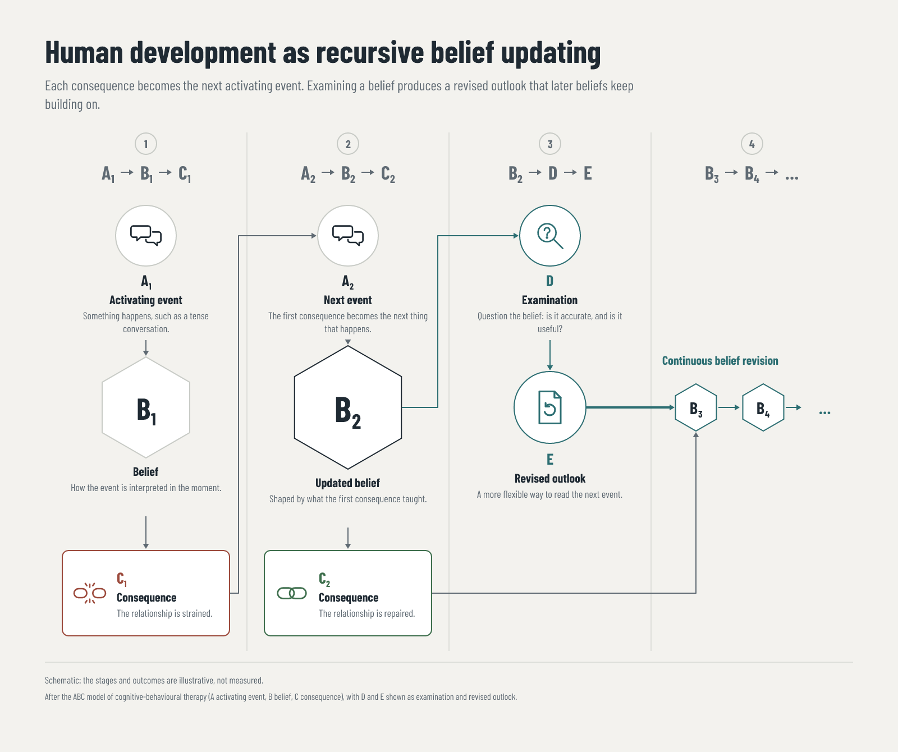

# Belief updating: a recursive-process diagram

A 1600×1340 explainer rendered through the trusted `recursive-process@1.0.0` recipe (`tools/recipes/recursive-process.mjs`). The copy, the palette and the formula tokens come from `fixture.json`; the layout, icons and checks come from the recipe and the shared `processRequest`. It recreates an operator-supplied reference ("Human Development: A Recursive Belief Updating Process"), revised under `SYSTEM-INSTRUCTIONS.md`. The reference image is not committed, because its provenance is unknown.



| File | What it is |
|---|---|
| `fixture.json` | The copy, palette and tokens; it is also the recipe's pinned schema |
| `render-diagram.mjs` | A thin caller; it renders into this folder's gitignored `out/` |
| `belief-updating.png` | Satori → resvg render |
| `belief-updating-chromium.png` | The same scene rendered by Playwright/Chromium |
| `receipt.json`, `receipt-chromium.json` | The engine's receipts for those renders. `inputPath` is made repo-relative; the rest is unchanged. |

## Reproducing

```sh
pnpm install --frozen-lockfile
node examples/2026-10-11-belief-updating/render-diagram.mjs                      # Satori PNG
node examples/2026-10-11-belief-updating/render-diagram.mjs --backend playwright # Chromium PNG
node examples/2026-10-11-belief-updating/render-diagram.mjs --format png,svg,html,html-inline
```

Each run publishes an immutable folder under `out/runs/`. Its receipt names `recursive-process@1.0.0` with `verified: true`.

## What the checks prove

- **Fit and containment:** every label, caption, title and footer line fits its region in both backends, through the shared fit loop.
- **Fixed-size tokens:** the formula tokens (A₁, B₂…) are not fit-checked. Their width is bounded instead: at most three tokens of one letter and one digit per stage.
- **Font:** Barlow Condensed (`tools/fonts/barlow-condensed/`) renders with no missing glyphs in Satori and loads in Chromium. Exported HTML loads both weights and every SVG image offline, with zero network requests (canary C1).
- **Validation:** the recipe refuses an unfittable caption, a fifth stage, a token outside `A–E` plus an optional digit, a polarity other than `negative`/`positive`, and an arrow glyph the font lacks. Each refusal is named (C1), and removing any of these guards turns C1 red.

## AS report (SYSTEM-INSTRUCTIONS.md)

Before composing, the brief was set as follows.

- **Reader:** someone learning how a belief, once examined, changes later outcomes.
- **Takeaway:** a consequence feeds back into the next belief, and examining a belief yields a revised outlook that keeps revising.
- **Hierarchy decisions:**
  1. The state hexagons are the largest objects, and the updated belief B₂ is larger and darker than B₁.
  2. The revision path (examination, revised outlook, continuous revision) is the only use of the accent colour.
  3. Stage numbers and formulas are a quiet, unboxed header row.

Patterns avoided, by rule:

- **AS-1:** the composition follows the cycle (event → belief → consequence → next event), not a hero-and-tiles template.
- **AS-2:** no gradients, glows or glass. The reference's gradient arrow became a solid accent line, and there is one accent with a stated role.
- **AS-3:** the reference boxed its all-caps title; here the title is sentence case with no container. Cards are used only for the two consequences, which are distinct objects.
- **AS-4:** unequal weight on purpose: B₂ is larger than B₁, and the accent marks the revision path.
- **AS-5:**
  - the palette roles are in the fixture;
  - strokes of 2 px for outlines and connectors, 1 px for rules and 4 px for the main revision line; one 12 px card radius; no shadows;
  - Barlow Condensed 700 for headings and tokens, 400 for copy;
  - line heights of 1.2 to 1.3. Barlow's line box is 1.2 em. At 1.1 Chromium reported the title and labels as overflowing at every fit attempt, and at 1.0 it shrank the stage numbers.
- **AS-6:** the reference's repeated, identical person-head icons were dropped as decoration. Each remaining icon depicts its step:
  - speech bubbles: an event between people;
  - a broken link: a strained relationship;
  - linked rings: a repaired relationship;
  - a magnifier with a question mark: examination;
  - a page with a rewrite arrow: revised outlook.
- **AS-7:**
  - The reference's stage 4 header was empty; here it states B₃ → B₄ ….
  - Its trail repeated B₂; here the trail starts at B₃.
  - The footer marks the diagram schematic and names the model it follows. There are no figures, quotes or sources beyond that.
- **AS-8:** the captions describe a concrete relationship example (a tense conversation, strained then repaired), not abstract filler.

Exceptions: none.

Inspected:
- both PNGs (Satori and Chromium) at full size and at a 400 px thumbnail. At thumbnail size the hierarchy holds and the captions blur, as expected;
- the HTML exports through the offline check in C1.

Human review of the artwork is pending.

## Limits

- **Fixed structure:** four stages, two A→B→C cycles, one examination branch and a three-token trail. A diagram that needs a different count needs a new recipe version.
- **Schematic content:** it is not a clinical description of the model.
