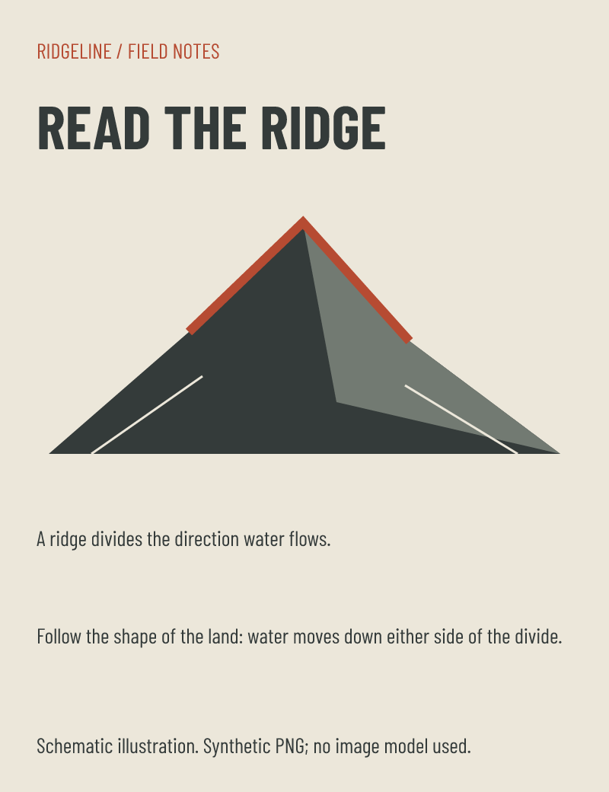

# DESIGN.md intake example

A neutral art-direction document translated by the active coding agent into a data-only recipe for the standard renderer. `fixture.json` contains structured settings, quoted requirement mappings, individual artwork prompts and pinned source/image digests. `ridge.png` is a **synthetic SVG-to-PNG illustration made with the installed Resvg**, not generated by an image model. No provider was invoked and no private project was used.



## Reproduce

From the repository root after `pnpm install --frozen-lockfile`:

```sh
node tools/intake.mjs capabilities
node tools/intake.mjs check examples/2026-10-12-design-intake/fixture.json
node tools/render.mjs examples/2026-10-12-design-intake/fixture.json --format png,svg,html,html-inline --out temp/intake/satori
node tools/render.mjs examples/2026-10-12-design-intake/fixture.json --backend playwright --format png,html,html-inline --out temp/intake/playwright
node --input-type=module -e "import {verifyPublication} from './tools/render.mjs'; console.log(await verifyPublication('temp/intake/satori')); console.log(await verifyPublication('temp/intake/playwright'));"
```

Resolve the `current` entry in each export's `manifest.json` to find its immutable artifacts. Compact HTML travels with its assets directory; inline HTML is standalone. The generated HTML is never edited. Sources and PNG previews are committed; disposable exports live in ignored `temp/`.

## Visual direction and report

Field-note explanation for hikers, schematic rather than surveyed data. Hierarchy: bold headline first, a single large ridge second, explanation/disclosure below. AS-1/4: content determines unequal scale; AS-2/3/6: flat fills, no gradients, badge ornaments or card grid; AS-5: Barlow Condensed, explicit palette/type/8px grid; AS-7/8: specific subject and honest synthetic disclosure; AS-9: separate descriptive prompt with shared style. No style-rule exception needed.

The producing agent inspected both backend PNGs at full size and together at thumbnail size. Both show the intended hierarchy with no observed collisions. Human visual acceptance remains pending. These are a workflow demonstration, not evidence of generative-image consistency or of semantic fidelity for arbitrary future documents.

## Verification and limits

Both standard renders and export verification passed. C1 exercises both backends, moved inline/compact exports with network blocked, source/hash drift, missing assets, traversal and symlink escape, unsupported font/glyphs, malformed fields, empty elements, overlapping/out-of-canvas regions, pending artwork, unsupported requirements, Playwright SVG, and an overflowing `header_caption` ID. A failed intake preserves the last publication manifest.

Initial browser render failed because a 1.1 headline line height placed the glyph range above its assigned box. Recipe-only correction to 1.3 passed; no fit guard was relaxed. Root cause: recipe line-height choice versus bundled font metrics; fix site: fixture typography; renderer correctly rejected clipped text.

Preflight is structural. It does not prove that requirements were complete or that prompts match the source, and rendering adds font/fit checks. Multiple font families, unsupported glyphs, gradients, arbitrary CSS and responsive layouts remain unsupported. A complex brand brief can therefore produce a useful blocked intake, rather than a silently simplified output.
