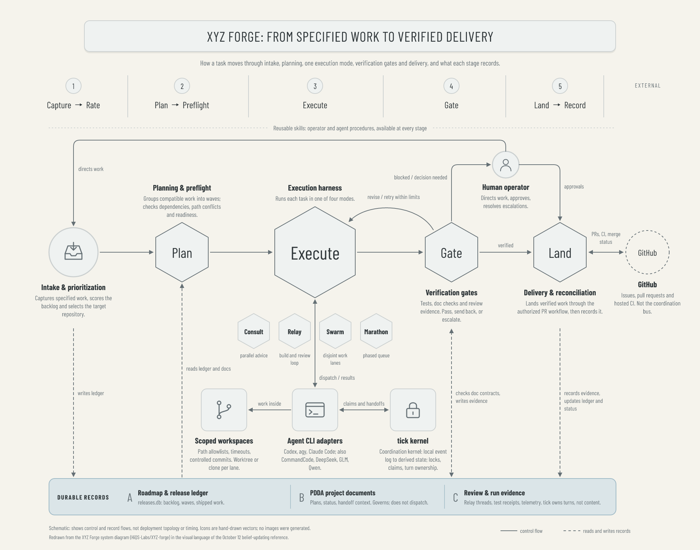

# Example: XYZ Forge system, in the belief-reference style

A 2000×1570 redraw of the XYZ Forge system diagram (dark, boxed, neon routes) in the visual language of the [October 12 belief-updating reference](../2026-10-12-belief-reference/README.md): warm ivory ground, charcoal Barlow Condensed type, a rounded title panel, numbered stage markers over short column rules, point-up hexagons on one horizontal reading line, thin slate connectors with rounded elbows, compact cards with labels underneath, and one pale blue-grey accent shape.



The diagram is schematic. It shows control and record flows, not deployment topology or timing. Icons are hand-drawn SVG; no images were generated and nothing was uploaded.

## What is here

| File | What it is |
|---|---|
| `xyz-forge-system.png` | Final Satori → resvg render |
| `xyz-forge-system-chromium.png` | Same scene rendered by Playwright/Chromium |
| `xyz-forge-system.html` | Self-contained responsive viewer |
| `fixture.json` | All copy and the palette roles |
| `render-diagram.mjs` | Owns the geometry, builds the scene, renders both backends, runs the checks, writes `verification.json` |
| `verification.json` | Text and icon ids, artifact digests, findings (empty on a pass) |

## How the belief reference maps onto the forge

| Belief reference | XYZ Forge |
|---|---|
| Stage markers 1–4 with A → B → C formulas | Stages 1–5 with the Capture → Rate → … → Record track |
| Activating-event circle | Intake circle (inbox icon) |
| Large B1/B2 hexagons on the reading line | Plan, Execute (largest), Gate, Land hexagons |
| Upper D → E branch from B2 | Human operator above the line: directs work, receives escalations, gives approvals |
| C1 curved feedback into B2 | Gate → Execute "revise / retry within limits" arc |
| Small B2/B3/B4 trail | Consult, Relay, Swarm, Marathon, drawn without arrows because they are alternatives, not a sequence |
| Consequence cards with labels below | Scoped workspaces, agent CLI adapters, tick kernel |
| Broad pale-blue continuation arrow | The durable-records shelf (ledger, PDDA documents, run evidence), the one accent shape |

## Visual direction and AS review

Reader: an engineer or operator learning how XYZ Forge carries a task from specification to verified delivery. Takeaway: one left-to-right line of five stages, with the execution harness at its centre, a gate that can send work back or escalate to a person, and durable records underneath everything.

Hierarchy decisions: (1) the five-stage reading line, with Execute as the largest node; (2) the operator routes above and the mode trail and runtime cards below, at smaller scale; (3) the records shelf, stage formulas and footer as orientation.

- **Avoided:** AS-2 (no glow, neon or gradients; solid palette fills), AS-3 (the source boxed every component and boxed boxes inside boxes; here only the title, runtime cards and records shelf are panels), AS-4 (unequal node sizes instead of equal cards), AS-6 (the source's mode thumbnails, legend chips and per-colour rails are gone; a two-sample line legend remains because solid and dashed carry meaning).
- **Exceptions:** the rounded title panel, hexagons and light title shadow deliberately match the reference (AS-2/AS-3/AS-6, same rationale as the reference README). Geometry lives in the script rather than the fixture, as in the reference recipe (AS-5).
- **Simplifications, stated:** record connectors land on the shelf as a whole and name the store in their labels, because no left-to-right order of the three stores matches all five stages. The execution harness's own "writes evidence" edge and the separate harness ↔ tick edge from the source are folded into the "Review & run evidence" entry and the adapters ↔ tick link to keep the lower half readable.
- **AS-7:** copy is taken from the source diagram; no numbers, sources or logos were added. GitHub is plain text in a dashed circle.
- **AS-10:** inspected both backend PNGs at full size and a 420px-wide thumbnail. The reading line and harness hold at thumbnail size; captions and connector labels need the full-size view. Backends differ only in sub-pixel type placement.

## Reproducing

From the repository root, with `pnpm install --frozen-lockfile` done and the repository's Playwright Chromium installed:

```sh
node examples/2026-10-14-xyz-forge-system/render-diagram.mjs
```

A pass prints `PASS: 77 text ids and 5 icons; 2000x1570 in both backends; no unsupported glyphs, escapes, overflow or overlap.` The checks are layout checks: glyph coverage, canvas and container containment, Chromium overflow and pairwise text overlap. They do not judge whether the picture is right. Rendered on macOS arm64, Node 22.22.3. Chromium cannot launch inside the Claude Code macOS sandbox (mach-port permission denied); run it outside the sandbox.
