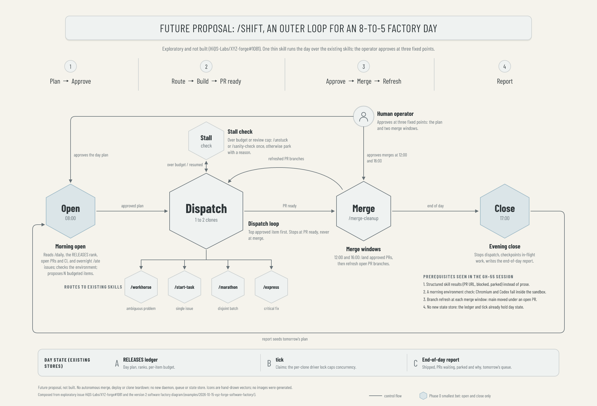

# Example: Future proposal, the /shift outer loop

A **future proposal**, not a description of anything built. It draws the outer loop explored in [HiQS-Labs/XYZ-forge#1081](https://github.com/HiQS-Labs/XYZ-forge/issues/1081): one thin `/shift` skill that runs an 8-to-5 factory day over the existing skills from the [version 2 software factory diagram](../2026-10-15-xyz-forge-software-factory/README.md). Same visual language as the belief-updating reference and the two earlier XYZ Forge diagrams.



## Reading the diagram

- **The day runs left to right.** 08:00 open → dispatch loop → merge windows (12:00 and 16:00) → 17:00 close. The end-of-day report loops back around the outside to seed the next morning's plan.
- **Three operator approvals, from above.** The day plan, and each of the two merge windows. Autonomy stops at PR ready; nothing merges without approval.
- **Dispatch is the largest node.** It routes the top approved item to an existing skill (`/workhorse`, `/start-task`, `/marathon`, `/express`) with at most 1 to 2 clones at a time. A stall check above it (`/unstuck` or `/sanity-check` once, otherwise park) keeps one item from holding the queue. After each merge window, refreshed PR branches return to dispatch.
- **Phase 0, the smallest bet, carries the single accent.** Only Open and Close are tinted: the morning plan and evening report, with the operator still invoking skills by hand.
- **Prerequisites** observed in the GH-55 session are listed as plain text, not boxed. **Day state** lives in existing stores only: the RELEASES ledger, `tick` and the end-of-day report.

## AS review

Reader: the operator and contributors deciding whether to build #1081. Hierarchy: (1) Dispatch and the day line; (2) Open, Merge, Close and the operator gates; (3) routed skills, stall check, prerequisites, day-state shelf and footer.

- **AS-7:** the title and subtitle say "future proposal" and "not built", and the footer repeats the non-goals (no autonomous merge, deploy or teardown; no new daemon, queue or store). Times and the 1-to-2 clone cap come from #1081, not measurement.
- **Exceptions:** the accent marks Phase 0 rather than a records shelf, so the day-state shelf here is plain surface; one accent role per diagram is kept. Title panel and hexagons match the earlier versions.
- **AS-10:** both backend PNGs inspected at full size. Fine captions need full size.

## Reproducing

From the repository root, with `pnpm install --frozen-lockfile` done and the repository's Playwright Chromium installed (run outside the Claude Code macOS sandbox, where Chromium cannot launch):

```sh
node examples/2026-10-15-xyz-forge-shift-proposal/render-diagram.mjs
```

A pass prints `PASS: 73 text ids and 1 icons; 2200x1500 in both backends; no unsupported glyphs, escapes, overflow or overlap.`
