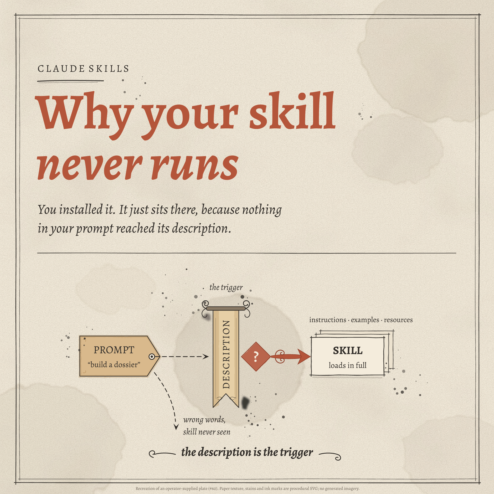

# Example: "Why your skill never runs"

A 1920×1920 recreation of an operator-supplied Claude Skills explainer plate (#60): aged parchment with watercolor stains, a hand-drawn double frame, a terracotta Alegreya title whose second line is italic, and a charcoal ink diagram. The plate makes one point: a skill loads only when something in the prompt reaches the skill's description. The description is the trigger.



The paper texture, stains, ink line work and splatter are procedural SVG built by the script with a fixed seed. No images were generated and nothing was uploaded.

## What is here

| File | What it is |
|---|---|
| `skill-trigger.png` | Final Satori → resvg render |
| `skill-trigger-chromium.png` | Same scene rendered by Playwright/Chromium |
| `skill-trigger.html` | Self-contained responsive viewer |
| `fixture.json` | All copy, palette roles and type settings |
| `render-diagram.mjs` | Owns the geometry, builds the paper and ink layers and the scene, renders both backends, runs the checks, writes `verification.json` |
| `verification.json` | Text ids, artifact digests, findings (empty on a pass) |

The type is Alegreya (`tools/fonts/alegreya/`, OFL) in four faces: regular, bold, italic and bold italic. The italics go to the shared renderer through the optional `font.faces` list in `tools/render.mjs`, added for this example. That file is pinned by the `design-intake` recipe, so this change also publishes `design-intake@1.0.4`, which differs from 1.0.3 only in that file's hash.

## How the diagram reads

Left to right on one line: the PROMPT tag ("build a dossier") sends a dashed arrow to the hanging DESCRIPTION banner, labelled "the trigger". A "?" diamond tests the match, and the accent arrow leads to the SKILL card stack, which "loads in full" with its instructions, examples and resources. A dashed branch drops from the tag for the miss: "wrong words, skill never seen".

## Visual direction and AS review

Reader: someone who installed a Claude skill and cannot see why it never fires. Takeaway: the closing line, "the description is the trigger".

Hierarchy decisions: (1) the two-line title, at the largest size and the only use of the accent in type; (2) the one-line diagram, with the banner as its tallest object at the centre of a wash; (3) the subtitle, annotations and closing line as supporting italics.

- **Avoided:** AS-3 (only the tag, banner and cards are shapes, because each is a distinct object in the story; the copy is not boxed), AS-4 (the title dominates, and the diagram's objects differ in size and form rather than sitting in equal tiles), AS-8 (a tag for the prompt, a hanging label for the description, a card stack for a skill's bundled files, rather than generic boxes).
- **Exceptions:** the watercolor stains, wash disc, paper grain, ink splatter, scroll finials and swashes break AS-2 and AS-6 deliberately. They are the source plate's medium, and the request was to recreate it. They are seeded and rendered once, so they do not vary between runs. The one accent colour has a role: the title, the match test and the path to the skill.
- **AS-5:** palette roles and type settings are in `fixture.json`; geometry lives in the script, as in the GH-55 examples. Alegreya is vendored with its license and hashes (`tools/fonts/alegreya/SOURCE.md`).
- **AS-7:** the copy is the source plate's, unchanged. The footer states that this is a recreation and that the texture is procedural, with no generated imagery.
- **AS-10:** inspected both backend PNGs at full size and a 480px thumbnail, side by side with the source. The title, diagram line and closing line hold at thumbnail size; annotations need the full-size view. The backends differ in sub-pixel type placement and texture resampling.
- **Differences from the source, stated:** the subtitle breaks after "nothing" rather than "because", because Alegreya sets wider than the source's face and a narrower box makes Chromium wrap to three lines. The arrow ornament, ink blot and stain placement are close approximations, not traces.

## Layout checks

The checks are the GH-55 set: glyph coverage, canvas and container containment, Chromium overflow and pairwise text overlap, in both backends. One check is added: the Chromium document must register both italic `@font-face` rules. Two adjustments, both in the script:

- DESCRIPTION is rotated. Satori reports layout boxes before transforms, so the script turns that label's Satori box to match what is drawn before checking it.
- The two title lines are set tighter than Alegreya's content area, as in the source, so their text boxes overlap while the glyphs do not. That one pair is exempt from the overlap check; the title is inspected visually instead.

## Reproducing

From the repository root, with `pnpm install --frozen-lockfile` done and the repository's Playwright Chromium installed:

```sh
node examples/2026-10-16-skill-trigger/render-diagram.mjs
```

A pass prints `PASS: 16 text ids; 1920x1920 in both backends; no unsupported glyphs, escapes, overflow or overlap.` Repeat runs produce the same digests. Rendered on macOS arm64, Node 22.22.3. Chromium cannot launch inside the Claude Code macOS sandbox; run it outside the sandbox.
