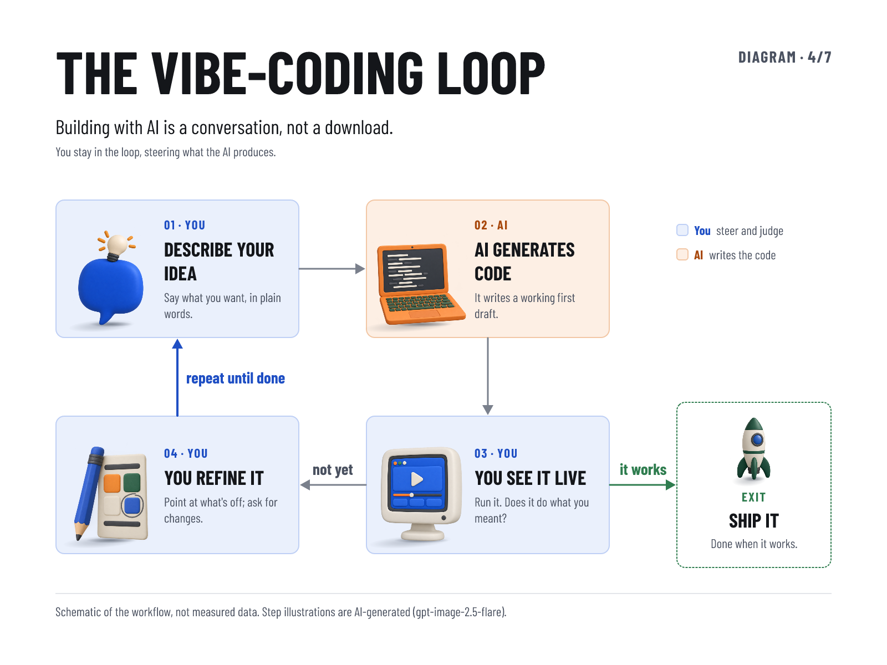

# The Vibe-Coding Loop

Slide 4/7 of an intro deck on building with AI: a four-step cycle (describe → AI generates → see it live
→ refine) with a "repeat until done" return and a "Ship it" exit. Each step carries a small generated
cutout standing on its card with a two-layer ground shadow. Built for
[#63](https://github.com/HiQS-Labs/XYZ-layout-engine/issues/63) through the lens of the
[nutrition infographic](../2026-10-13-nutrition-infographic/): a [DESIGN.md](DESIGN.md) brief, a fixture
that owns copy and palette, an AS-12 type scale and pinned PNG cutouts.



- [Satori PNG](vibe-coding-loop.png) · [Chromium PNG](vibe-coding-loop-chromium.png) ·
  [responsive HTML](vibe-coding-loop.html) · [verification.json](verification.json)
- Design brief: [DESIGN.md](DESIGN.md) · cutouts and provenance: [ASSETS.md](ASSETS.md)

## What changed from the source slide

The supplied slide drew five numbered circles on a dashed ring. The ring ran through the circles,
numbers and labels; nothing showed direction; "Repeat until done" was a fifth step; and the caption
(idea → generation → review → refinement → loop) did not match the nodes. Here the loop is four steps,
every connector has a direction, "repeat until done" labels the return arrow, step 03 is the decision
("not yet" → refine, "it works" → exit), and actor colour shows that three of the four steps are yours.
The structure was first reviewed on a Claude Design canvas.

## Files

| File | Owner of |
|---|---|
| `fixture.json` | all copy, palette roles, type percentages, asset ids and visible boxes |
| `render-diagram.mjs` | geometry, ground shadows, connectors, layout and AS-12 checks |
| `artwork.json`, `provenance.json`, `receipts/`, `assets/web/` | cutout prompts, pins and display PNGs |
| `vibe-coding-loop*.png`, `.html`, `verification.json` | generated outputs |

No recipe or catalog entry: this is a one-off example (GH-55/GH-60 pattern). It imports the shared
`renderSatori` / `renderPlaywright` and `readPinnedPngs` and edits no pinned file.

## Replay

```sh
pnpm install
node examples/2026-10-17-vibe-coding-loop/render-diagram.mjs
```

Prints `PASS` and rewrites both PNGs, the HTML and `verification.json`. Chromium cannot launch inside the
Claude Code macOS sandbox; run it un-sandboxed. `FIXTURE=<path>` renders a different fixture and
`OUT_DIR=<dir>` writes outputs elsewhere (used by the red controls). Two consecutive runs give identical
digests.

## AS-1..AS-12 report (`SYSTEM-INSTRUCTIONS.md`)

Before composing: reader, takeaway and hierarchy decisions are in [DESIGN.md](DESIGN.md) → Overview;
`S = min(1600, 1200) = 1200`; type scale 108 / 36 / 29 / 23 px (9.0 / 3.0 / 2.4 / 1.9% of S).

Patterns avoided:

- **AS-1, AS-4:** composition starts from the cycle, not headline + hero + tiles. The loop takes the
  centre; the exit is smaller and dashed; the return connector is the heaviest.
- **AS-2:** no gradients on surfaces, no glows or sparkles. The only gradients are the ground-shadow
  falloffs, which AS-11 calls for.
- **AS-3:** cards are used for genuinely distinct objects (the steps and the exit). Header, legend and
  footer are unboxed.
- **AS-5:** one family (Barlow Condensed, the vendored default), one radius (16 px), one 2 px outline,
  palette roles named in the fixture.
- **AS-6, AS-8:** each cutout depicts its step (speech bubble with a bulb, a laptop of code, a monitor
  playing the app, a pencil marking a layout, a rocket). No ornaments.
- **AS-7:** copy is the operator's slide copy; the footer says the diagram is schematic and that the
  illustrations are AI-generated.
- **AS-9:** one shared style string describing subject, view, light, background and exclusions, with no
  quality boosters.
- **AS-11:** each cutout stands on its card's floor line with a contact ellipse plus a lower-left cast
  ellipse from one upper-right light; no silhouette drop-shadows.

Exceptions used: none.

Measured AS-12 checks (from `verification.json`, both backends):

| Check | Rule | Measured |
|---|---|---|
| Headline | 7–10% of S | 9.0% (108 px) |
| Headline width | 50–85% of canvas | 55.3% (Satori text box) |
| Body | ≥ 1.8% of S | 1.9% (23 px) |
| Headline : body | ≥ 4 : 1 | 4.7 : 1 |
| Distinct sizes | ≤ 4 | 4 (108 / 36 / 29 / 23) |
| Largest graphic vs headline cap height | ≤ 3× | 170 px vs 75.6 px cap → 2.25× |
| Legend label vs swatch | ≥ 70% | 23 px text, 22 px swatch → 105% |

Inspected (AS-10): both PNGs at full size side by side (layout and type match; no connector crosses a
card, cutout or label); the Satori PNG at 533 px wide (1/3 scale) and the Chromium PNG at 400 px wide
(phone). In both, headline, card titles and everything else stay three distinct tiers (squint test), and
the title, card titles, actor tags and connector labels read. The 23 px captions, legend and footer
(about 6–8 px at those widths) do not read without zoom, although they meet the AS-12 1.8% floor: the
loop is legible on a phone, the step captions are not. A first render left the diagram's top-right cell
empty (AS-12 rule 7), so the legend moved there.
