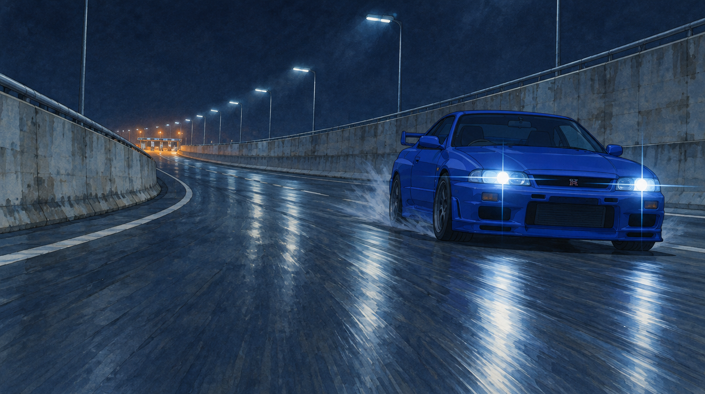
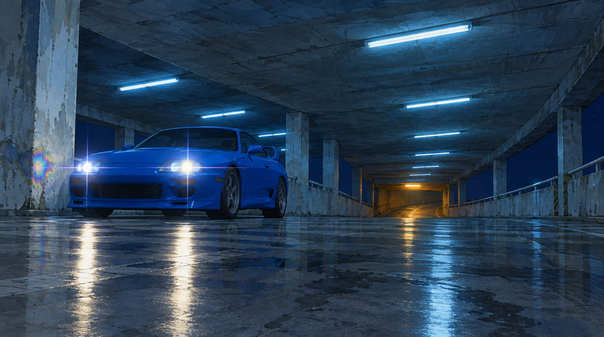

# Tunnel Run — anime style POCs

First proof-of-concept stills for **Tunnel Run**: late-1990s Japanese theatrical anime, a hand-painted gouache world with a cel-shaded hero car, cool light near and warm light far. Tracked in [#68](https://github.com/HiQS-Labs/XYZ-layout-engine/issues/68).

- [STYLE-GUIDE.md](STYLE-GUIDE.md): the art direction guide, covering palette, light, rendering, composition, animation, the prompts and the acceptance check.
- [prompts/](prompts/): the guide's base style block and the two scene lines, exactly as sent.
- [gen.sh](gen.sh): one priced, single create per run (`./gen.sh poc1 [quality]`). It writes outside the repo.
- [provenance.json](provenance.json): the job id, settings, credits and sha256 for each committed image.
- [assets/](assets/): the two round-1 stills, 1344×752.

## Round 1 (2026-10-26)

Settings: `gpt_image_2_5`, `flare`, `medium`, `1k`, `16:9`, `opaque`. Each image cost 0.5 credits, quoted and measured by balance; 1.0 in total.

| Check | POC 1: Expressway | POC 2: Parking structure |
|---|---|---|
| Painted world, cel hero | ✅ | ⚠️ floor and ceiling drift toward a 3D render |
| One saturated colour + small warm accent | ✅ | ✅ (oil-sheen patch too loud) |
| Cool near, warm far | ✅ | ✅ |
| No readable text or logos | ❌ GT-R-style grille badge | ✅ |
| Palette within a tint shift | ✅ | ✅ |
| Other | Tyre spray breaks "no visible droplets"; lamp posts instead of a strip-light line | Composition matches the brief |

## Rules followed

`SOP.md`'s spend rules, applied to opaque images: a credit cap from the operator ($10 per session, counted as 10 credits until the credit→USD rate is known), a price check before every create, one create per price check, no retries after an unclear result, and no local reference uploads. The transparency check doesn't apply because these are full-frame scenes. Signed result URLs and account details are not recorded.
