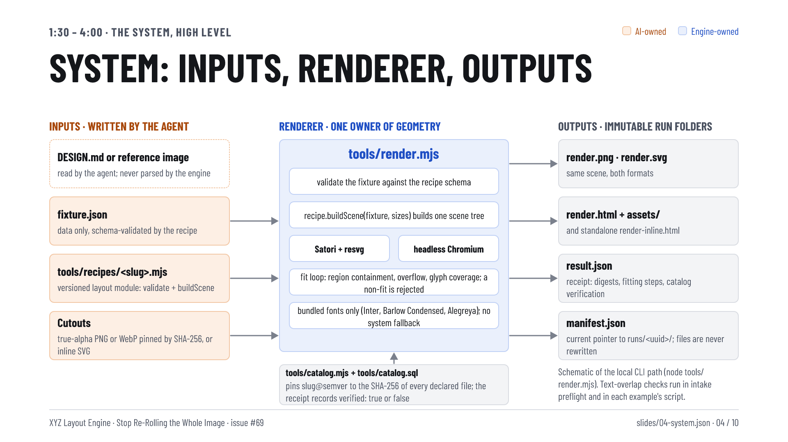

# Stop Re-Rolling the Whole Image — the talk deck

Ten 1920 × 1080 slides for the 18-minute talk outlined in
[#69](https://github.com/HiQS-Labs/XYZ-layout-engine/issues/69), rendered by XYZ Layout Engine itself. Every
slide is a JSON fixture under [slides/](slides/), rendered through the shared `tools/render.mjs`
`renderSatori` / `renderPlaywright` in both backends, with the deck's palette and AS-12 type scale owned by
[deck.json](deck.json) and the geometry, vector ink and checks owned by [render-deck.mjs](render-deck.mjs).
No slide is an image-model output; no image model was called. Design brief: [DESIGN.md](DESIGN.md).



| # | Fixture | Shows | Layout |
|---|---|---|---|
| 01 | `slides/01-title.json` | title, subtitle, abstract, the dogfood statement | `title` |
| 02 | `slides/02-reroll-tax.json` | the hook: the real nutrition render; image model vs engine on "change only the headline" | `reroll` |
| 03 | `slides/03-split.json` | AI owns taste, art direction, copy, cutouts; the engine owns geometry, type, checks, export; the hand-off files | `split` |
| 04 | `slides/04-system.json` | **system diagram:** inputs → `tools/render.mjs` (validate, buildScene, Satori + resvg / headless Chromium, fit loop, bundled fonts) → outputs and immutable run folders; `tools/catalog.mjs` pins recipe versions | `system` |
| 05 | `slides/05-workflow.json` | **workflow diagram:** author once (agent) → hand-off → render, `--set`, `--save`, rerender → identical bytes; "next edit" return | `workflow` |
| 06 | `slides/06-demo-setup.json` | the exact live-demo commands from #69, what to watch, environment notes | `demo` |
| 07 | `slides/07-before-after.json` | the real before and after renders, the changed fields, the matching SVG hash, "under a second" | `compare` |
| 08 | `slides/08-recipes.json` | versioned modules, hash-pinned catalog, new versions on change, data-only fixtures; the four active recipe identities | `recipes` |
| 09 | `slides/09-design-md.json` | Google Labs' alpha DESIGN.md, translated by an agent and never parsed by the engine; the intake flow; the line-height story; blocked intake | `designmd` |
| 10 | `slides/10-close.json` | three ways to drive it (cloud agent, local LLM, CI with no AI) and three takeaways | `close` |

Outputs: `renders/<slug>.png` (Satori + resvg) and `renders/<slug>-chromium.png` (headless Chromium) for
each slide, [deck.pdf](deck.pdf) (the ten Satori PNGs as pages, via Playwright's Chromium) and
[verification.json](verification.json) (per-slide AS-12 measurements, text ids, digests, declared
exceptions, findings). The demo renders embedded on slides 2 and 7 are pinned in
[provenance.json](provenance.json) with their `result.json` / `manifest.json` under [receipts/](receipts/).

## Files

| File | Owner of |
|---|---|
| `deck.json` | canvas, palette roles, type percentages, slide order, legend, footer |
| `slides/NN-slug.json` | every word on that slide, its layout name, any declared AS-12 exception |
| `render-deck.mjs` | geometry, arrows and rules (SVG ink layer), layer order, AS-12 and layout checks, outputs |
| `deck-pdf.mjs` | optional: `deck.pdf` from the Satori PNGs, dates normalised so the bytes repeat |
| `assets/web/`, `provenance.json`, `receipts/` | the two demo renders, their pins and receipts |
| `renders/`, `deck.pdf`, `verification.json` | generated outputs |

No recipe, catalog, renderer, font or test change: a one-off example in the GH-55/GH-60/GH-63 pattern.

## Reproduce

From the repository root, on Node 22.2 or newer (verified on v26.0.0; Node 18 fails on `node:zlib`
`crc32`), after `pnpm install --frozen-lockfile` (or `npx --yes pnpm@9 install --frozen-lockfile` when pnpm
is not on PATH) and a Playwright Chromium matching the installed Playwright
(`node node_modules/playwright/cli.js install chromium`):

```sh
node examples/2026-10-29-talk-deck/render-deck.mjs
node examples/2026-10-29-talk-deck/deck-pdf.mjs
shasum -a 256 examples/2026-10-29-talk-deck/renders/*.png examples/2026-10-29-talk-deck/deck.pdf
```

The first command prints one `ok` line per slide and `PASS: 10 slides at 1920x1080 in both backends; AS-12
sizes 97/36/29/24 px; no unsupported glyphs, escapes, overflow or overlap.`, rewriting the twenty PNGs and
`verification.json`. Two consecutive runs on 2026-10-29 gave identical digests for every PNG and for
`verification.json`; `deck.pdf` also repeated byte for byte. The Satori PNG digests:

| Slide | `renders/<slug>.png` sha256 |
|---|---|
| 01-title | `13d76f7e18654f6d6209a04896c5e27cf14daf8e613a39433cf3686376c219af` |
| 02-reroll-tax | `a4e85e37bea55eb5e136187821f3a5efc7fac63e6f3e2f895530d1e6ebfea876` |
| 03-split | `e184c96bf18afcc90aead42be2dd58bab0f408d0f184323f1cd6ff9ae1e60415` |
| 04-system | `323bb16899a00cdc75401c5d733b8aca2b83ba6f5ff9908aacd2550944c91f0f` |
| 05-workflow | `b5ad9f35ad24d0c0e9cdd57ac45e5508e9cf7e3a2915e7eb32caa81982409d4e` |
| 06-demo-setup | `204a90a3ed402cf4357f2302eddacf7e5a1f13e3ffe5d2d2e0784deaf3673a13` |
| 07-before-after | `d9bc574d85034098de9d54ab5cf7bec3785f14316195e44aa7b1109edc26ddca` |
| 08-recipes | `38244bf5c45e6e2cad55a31d2a5f8109c54dd9102819892a12eb1d20fac148d5` |
| 09-design-md | `7a7d3edc09d7769282662e6e63cd1067f0a49adc5753ff684306432515802ba7` |
| 10-close | `dc2f2baa9d202ffb95891a4943363508eef36b1d678097a6c8b0e979af49c2d6` |

The Chromium PNG digests are in `verification.json` (`artifactDigests.chromiumPng`). `deck.pdf`:
`d06e7adf3da2ceba0df72909f8103eff0630631f6e1074839ede603810692729`. Chromium cannot launch inside the
Claude Code macOS sandbox; run un-sandboxed. `SLIDES=04-system,05-workflow` renders a subset without
rewriting `verification.json`; `DECK=<path>` renders another deck fixture and `OUT_DIR=<dir>` writes
outputs elsewhere (for red controls).

To rebuild the two embedded demo renders, run the six commands in `provenance.json` (they are the #69
live-demo script) and copy the before and after `render.png` over `assets/web/`; the pins in
`provenance.json` must then be updated to the new digests. The deck itself does not need this: the pinned
copies are committed.

## What the checks cover

`render-deck.mjs` fails (exit 1, findings in `verification.json`) when any slide, in either backend, has
text outside the canvas, text escaping its declared container, two text boxes overlapping, text over an
image, text crossing the footer rule, single-line copy (commands, titles, labels) wrapping, Chromium
scroll overflow, an unsupported glyph, or an AS-12 violation (more than four sizes, headline outside
7–10% of S or 50–85% of the canvas width, body under 1.8% of S, ratio under 4:1, a graphic taller than
3× the headline cap height without a declared exception, legend labels under 70% of the swatch). During
layout these checks caught a headline line height of 1.05 that clipped in Chromium (fixed to 1.2 in the
script, no guard loosened), a two-line "headless Chromium (Playwright)" label (copy shortened) and a catalog
strip too short for its text (strip enlarged).

## AS-1..AS-12 report (`SYSTEM-INSTRUCTIONS.md`)

Before composing: reader, takeaway and the three hierarchy decisions are in [DESIGN.md](DESIGN.md) →
Overview; `S = min(1920, 1080) = 1080`; type scale 97 / 36 / 29 / 24 px (9.0 / 3.3 / 2.7 / 2.2% of S).

Patterns avoided:

- **AS-1, AS-4:** each slide starts from its one claim; the headline is the heaviest element, the
  statement or diagram the largest, support copy smallest. No equal tile grids: the two diagrams use cards
  only for pipeline stages and files; the close slide weights takeaways over the three ways.
- **AS-2:** flat fills, no gradients, glows, blobs or panel shadows anywhere.
- **AS-3:** lists, columns, hairlines and a ledger carry most content; cards appear only for stages, files
  and outputs in the diagrams.
- **AS-5:** one family (Barlow Condensed), one radius, one outline, palette roles named in `deck.json`,
  sizes computed from S in the script.
- **AS-6:** the only colour-coded elements (owner bars, swatches, box fills) encode who owns what, with a
  legend; no icons or ornaments.
- **AS-7:** every number on the slides is measured (hashes, seconds, versions, digests from the catalog);
  the two slides with imagery disclose the AI-generated cutouts inside the renders.
- **AS-8:** the hook and result slides show the real nutrition render, not a stand-in; the diagrams name
  the real files and functions.
- **AS-11:** no cutouts are placed by this deck; the embedded renders keep the nutrition recipe's ground
  shadows.

Exceptions used: slides 02 and 07 embed renders 640 px and 600 px tall, 9.4× and 8.8× the 67.9 px headline
cap height (AS-12 rule 5 allows about 3×). They are the subject of those slides; the exception is declared
in each fixture (`as12Exception`) and recorded under `exceptions` in `verification.json`.

Measured AS-12 checks (from `verification.json`, both backends):

| Check | Rule | Measured |
|---|---|---|
| Headline | 7–10% of S | 9.0% (97 px) on every slide |
| Headline width | 50–85% of canvas | 52.4% (slide 05) to 72.9% (slide 09), one line everywhere |
| Body | ≥ 1.8% of S | 2.2% (24 px) |
| Headline : body | ≥ 4 : 1 | 4.04 : 1 |
| Distinct sizes | ≤ 4 | 4 (97 / 36 / 29 / 24); slides 05, 07, 08 use 3 |
| Largest graphic vs headline cap height | ≤ 3× | 0 on eight slides; 9.43× and 8.84× on 02 and 07 (declared exceptions) |
| Legend label vs swatch | ≥ 70% | 24 px text, 22 px swatch → 109% |

Inspected (AS-10): all twenty PNGs at full size (Satori and Chromium agree on layout and type; the arrows
cross no card or label; the double hyphens in `--set` / `--save` print as two hyphens after ligatures were
disabled); a contact sheet of both backends at 640 px (1/3 scale) and 400 px (phone). At 640 px the
headlines, section labels, diagram boxes and card titles read and three tiers survive the squint test; the
24 px body copy and commands do not read without zoom. At 400 px only the headlines and the two nutrition
renders read: the deck is a projector artefact, legible as a phone thumbnail only at the title level.

## Limits

- The "two re-rolls side by side" hook slide in #69 needs two image-model regenerations; the deck shows the
  real render and says so. No paid image call was made.
- `README.md` (root) and #69 name `tools/spike/measure-chromium.mjs`; that file is not in the tree or in
  git history. The deck describes the checks where they live: `tools/render.mjs` (containment, overflow,
  glyph coverage, fitting), `design-intake` preflight (text-region overlap) and each example's script
  (text overlap). The root README wording is a separate fix.
- Commands and everything else are set in Barlow Condensed; no monospace face is vendored and AS-5 allows
  at most one body and one display face.
- `deck.pdf` is a raster deck (one PNG per page), not the tagged accessible PDF `tools/pdf.mjs` produces for
  single scenes.
- Human visual acceptance of the deck is pending; the producing agent reviewed it.
