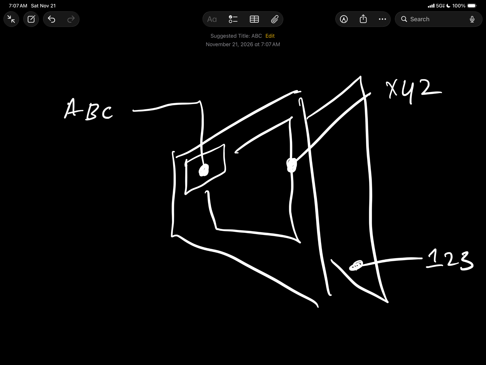

# How a poster is assembled

**Do not scan or read files and folders outside your handout packet.** Work in this packet and write deliverables under `output/`. You may execute the supplied runtime. The only optional external service is an operator-provided Higgsfield generation tool, under the conditions below.

Make a presentation-quality visual explanation of how XYZ Layout Engine assembles the supplied “Fuel Well. Live Well.” poster. Design for someone seeing the engine for the first time. After one look, they should be able to point to what they would edit to change the headline, swap the leaf, or move it on the page.

The sketch suggests depth and assembly. Decide how the parts should occupy space, overlap or come into focus. You may reinterpret the sketch. Choose your own visual metaphor, perspective technique, materials, transitions and annotation style. Make at least one relationship easier to understand through the composition itself. Keep the nutrition example recognizable.

Use the supplied source to explain one actual leaf placement or style value, when the JavaScript recipe runs, what CSS does in the HTML output, and where Satori, resvg and Chromium fit. Show how the viewer’s experience differs between an offline HTML poster and an exported image. Choose how to tell that story.

If the operator provides Higgsfield access and a written per-run credit cap, you may generate specialized artwork. Use it only where it helps explain something. The tool is optional. Use text prompts or assets explicitly cleared by the operator for upload. Keep generated assets in the packet so the final render works offline. Stop paid generation at the cap. If the tool or cap is absent, complete the brief with the packet assets and local tools.

Deliver editable source, a one-command render, a presentation PNG and self-contained offline HTML. In your editing notes, name the visual decision that most helps the viewer understand the engine. If you generated assets, record the prompts, model, settings and credits spent. Inspect the result at presentation and thumbnail sizes.

All paths below are relative to the packet root.

- `assets/perspective-sketch.png` is the operator’s sketch.
- `nutrition/fixture.json` and `nutrition/assets/web/` contain the poster content and transparent illustrations.
- `nutrition/render.png` and `nutrition/render-inline.html` are the finished nutrition poster and its offline HTML.
- `source/nutrition.mjs` and `source/render.mjs` are reference source files for the recipe and renderer. Use them to check technical claims.
- `fonts/` contains the bundled regular and bold typefaces and license.

Read `GOALS.md` in the handout for the public 100-point acceptance criteria and exact output names.
