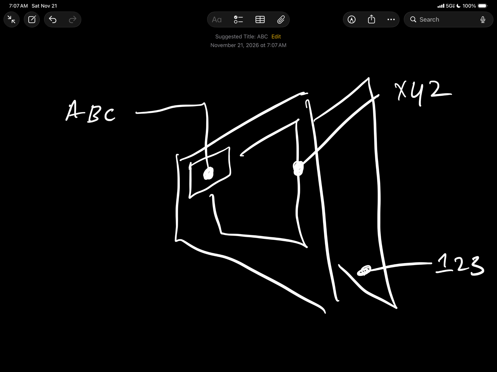

Create a visually striking, annotated diagram for someone seeing XYZ Layout Engine for the first time. Use the “Fuel Well. Live Well.” nutrition poster to show how the engine assembles a page. A viewer should be able to explain what changes if the author edits the headline, replaces the leaf artwork, or changes the layout recipe.

Use the sketch as a composition cue: two or three separated, diagonal screen-like planes recede toward a common perspective horizon. Put real, recognizable parts of the nutrition example on the planes. Use semi-transparent, feathered artwork so the relationship between layers reads clearly; keep the annotated captions crisp. Choose your own composition, palette, wording, and treatment. The finished piece should stand on its own as an attractive “how it works” graphic.

Ground the explanation in the local implementation. Investigate the roles of HTML text, transparent illustration assets, styling and recipe JavaScript; distinguish what runs during authoring/rendering from what a viewer actually receives. The exploded view is an explanatory model.

Inputs (paths relative to repository root):
- `examples/2026-11-21-imaging-layer-pipeline/assets/perspective-sketch.png` — supplied sketch; inspect it visually.
- `examples/2026-10-13-nutrition-infographic/` — fixture.json, assets/web/, and the current renders-v4.1/playwright/ poster and offline HTML.
- `tools/recipes/nutrition.mjs` and the shared local renderer — ground truth for the example.

Deliver a new, editable, locally reproducible example under `examples/2026-11-21-imaging-layer-pipeline/`, following repository design and review conventions. Include a one-command render, a presentation-quality PNG, and an offline HTML view. Preserve this single prompt and its reference image for future independent model runs. Use existing assets and installed tools. Inspect the finished image at full and reduced size. Limit changes to this example and its review outputs.
