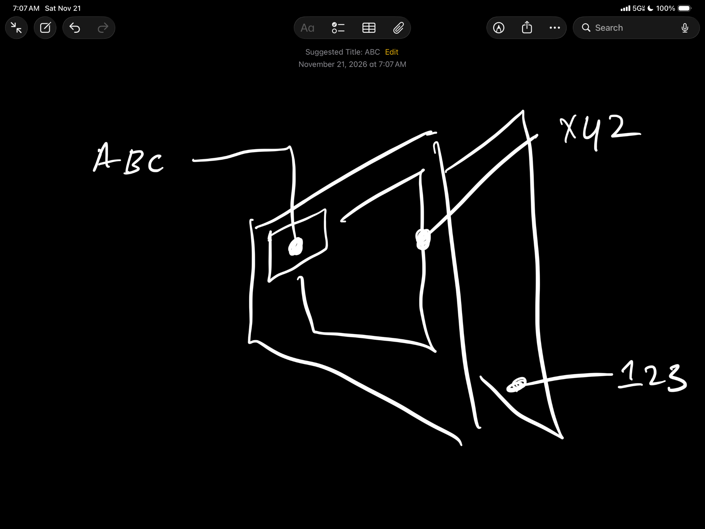

# Imaging layer pipeline benchmark

**Do not scan or read files and folders outside your handout packet.** Treat the extracted packet as your entire workspace. This includes file listings, search tools, repository history, parent directories, symlinks leading outside the packet, and external lookups. Use the provided Node.js, Playwright and Chromium runtime to execute your work. If an input or runtime capability is missing, report it. Write your solution inside `output/` in the packet.

Create a visually striking, annotated diagram for someone seeing XYZ Layout Engine for the first time. Use the “Fuel Well. Live Well.” nutrition poster to show how the engine assembles a page. A viewer should be able to explain what changes if the author edits the headline, replaces the leaf artwork, or changes the layout recipe.

Use the sketch as a composition cue: two or three separated, diagonal screen-like planes recede toward a common perspective horizon. Put real, recognizable parts of the nutrition example on the planes. Use semi-transparent, feathered artwork so the relationship between layers reads clearly; keep the annotated captions crisp. Choose your own composition, palette, wording, and treatment. The finished piece should stand on its own as an attractive “how it works” graphic.

Ground the explanation in the local implementation. Investigate the roles of HTML text, transparent illustration assets, styling and recipe JavaScript; distinguish what runs during authoring/rendering from what a viewer actually receives. The exploded view is an explanatory model.

Show where the layout rules enter the picture. Trace one real leaf property from the nutrition JavaScript recipe through the styled scene to the inline CSS in the HTML export. Annotate what changes on the next render if the author edits that value. Make clear that the recipe runs in Node.js before the viewer opens the poster.

Draw two labeled branches from that same scene. Satori lays it out as SVG, and resvg rasterizes the SVG when PNG is requested. On the browser branch, Playwright opens the styled HTML in Chromium, which lays it out and captures a PNG. Show where offline HTML with selectable text and embedded artwork is available with either backend. Keep this explanation visually connected to the leaf so a first-time viewer can follow it without reading the source code.

Build the diagram’s own perspective as editable HTML and CSS. Give the sheets a shared perspective origin, use CSS transforms for their angles, and use opacity and an edge mask to feather the artwork while keeping the captions sharp. Choose the angles, spacing and feather strength yourself. Use the original transparent illustration assets. To isolate the poster’s lettering, you may hide its artwork and backgrounds in the existing offline HTML and capture the text on transparency. Use Playwright and Chromium to render the finished diagram to PNG. Keep the offline HTML available so a reviewer can inspect and change the projection.

## Supplied inputs

All paths below are relative to the packet root.

- `assets/perspective-sketch.png` is the operator’s sketch.
- `nutrition/fixture.json` and `nutrition/assets/web/` contain the poster content and transparent illustrations.
- `nutrition/render.png` and `nutrition/render-inline.html` are the finished nutrition poster and its offline HTML.
- `source/nutrition.mjs` and `source/render.mjs` are reference source files for the recipe and renderer. Use them to check technical claims.
- `fonts/` contains the bundled regular and bold typefaces and license.

Deliver an editable example, a one-command render, a presentation-quality PNG, and an offline HTML view in `output/`. Inspect the finished diagram at full and reduced size.

Read `GOALS.md` in the handout for the public 100-point acceptance criteria and exact output names.
