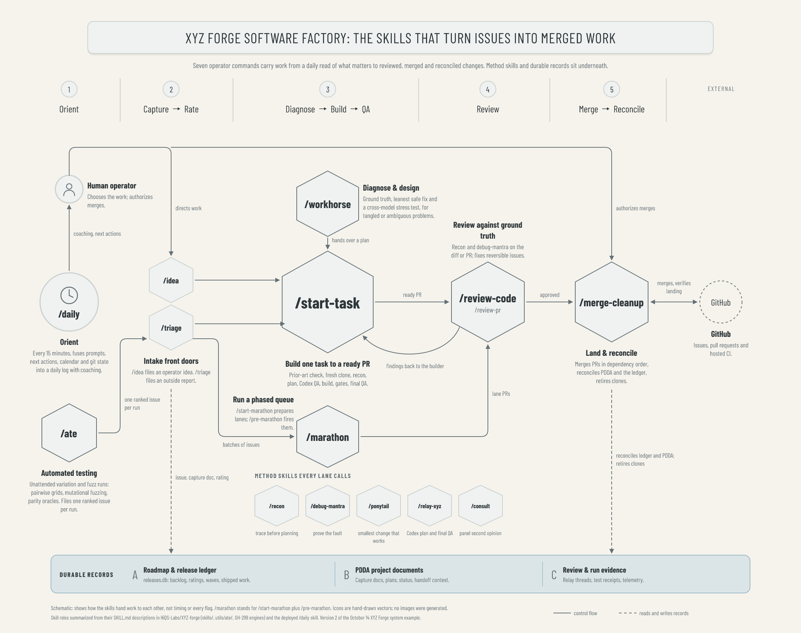

# Example: XYZ Forge software factory (version 2)

Version 2 of the [XYZ Forge system diagram](../system-v1/README.md). Version 1 drew the runtime: stages, harness modes, adapters, tick and records. This version makes the operator's commands the subject. It shows the seven skills that move work through the factory and how they hand work to each other: `/daily`, `/workhorse`, `/start-task`, `/marathon`, `/review-code` (alias `/review-pr`) and `/merge-cleanup`. It uses the same visual language as the belief-updating reference and version 1.



The diagram is schematic. Skill roles are summarized from each skill's `SKILL.md` description in HiQS-Labs/XYZ-forge (`skills/`) and the deployed `/daily` skill. `/marathon` stands for `/start-marathon` (prepares lanes and a dry run) plus `/pre-marathon` (fires them after operator confirmation). Icons are hand-drawn SVG; no images were generated.

## What is here

| File | What it is |
|---|---|
| `xyz-forge-software-factory.png` | Final Satori → resvg render |
| `xyz-forge-software-factory-chromium.png` | Same scene rendered by Playwright/Chromium |
| `xyz-forge-software-factory.html` | Self-contained responsive viewer |
| `fixture.json` | All copy and palette roles |
| `render-diagram.mjs` | Owns the geometry, renders both backends, runs the checks, writes `verification.json` |
| `verification.json` | Text and icon ids, artifact digests, findings (empty on a pass) |

## Reading the diagram

- **Operator loop (top left).** `/daily` synthesizes prompts, next actions, calendar and git state every 15 minutes and coaches the operator, who directs work into intake and authorizes merges.
- **Intake.** `/idea` (operator idea) and `/triage` (outside report) file the issue, capture doc and rating. They are drawn smaller because the operator did not name them; they show where work enters.
- **Automated testing (bottom left).** `/ate` runs unattended variation and fuzz suites (pairwise grids, a mutational fuzz engine and parity oracles across the agent CLI adapters, from `utils/ate/` and the GH-299 engines) and ends each run by filing one severity-ranked GitHub issue, which enters through `/triage`.
- **Build (centre column).** `/start-task` is the largest node: one task from a prior-art check (open and merged PRs, issues, the ledger, so nothing already tracked or fixed is redone) through a fresh clone to a ready PR. `/workhorse` sits above it for tangled problems and hands it a plan. `/marathon` sits below as the batch alternative whose lanes also produce PRs.
- **Review and land.** `/review-code` reviews against ground truth and sends findings back to the builder; `/merge-cleanup` merges in dependency order, reconciles PDDA and the ledger, and retires clones.
- **Method skills (bottom trail).** `/recon`, `/debug-mantra`, `/ponytail`, `/relay-xyz` and `/consult` are called inside the lanes rather than invoked as stages, so they sit under the line without arrows.

## AS review

Reader: an operator or contributor learning which command to reach for at each step. Hierarchy: (1) `/start-task` and the reading line; (2) `/workhorse`, `/marathon`, `/review-code`, `/merge-cleanup` and `/daily` at the second scale; (3) intake, method skills, records shelf and footer.

- **Avoided:** AS-3 and AS-4 (no equal grid of skill cards; scale follows role), AS-6 (only two icons, each depicting its node: a clock for the 15-minute cadence and a person for the operator).
- **Exceptions:** title panel, hexagons and title shadow match the belief reference, as in version 1. Geometry lives in the script (AS-5).
- **Simplifications, stated:** `/start-task` and `/marathon` also write intake records and evidence. Only the intake and merge record connectors are drawn, to keep the centre readable. `/workhorse` can also be invoked directly, without handing off to `/start-task`.
- **AS-10:** both backend PNGs inspected at full size, plus a 440px-wide thumbnail and close crops of the `/marathon` area. Fine captions need full size.

## Reproducing

From the repository root, with `pnpm install --frozen-lockfile` done and the repository's Playwright Chromium installed (run outside the Claude Code macOS sandbox, where Chromium cannot launch):

```sh
node examples/xyz-forge/today/software-factory-v2/render-diagram.mjs
```

A pass prints `PASS: 86 text ids and 2 icons; 2200x1740 in both backends; no unsupported glyphs, escapes, overflow or overlap.`
